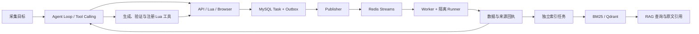

# GoRelay

**Agent 自主接入与可靠执行系统**

GoRelay 面向技术团队的信息监测需求，持续采集软件更新、API 变更等分散信息。Agent 负责探索新来源、编写并验证采集工具；Go 后端复用已验证工具执行任务，工具失效后再按需修复。采集结果进入独立知识链路，支持事实检索与原文追溯。

项目以 **Agent Loop、Code as Action、Tool Calling 与可靠执行** 为主线：让模型负责规划和修复，让程序负责可重复的执行。

## 核心能力

| 能力 | 关键设计 |
|---|---|
| 动态工具构建 | 将分页、详情关联和字段转换编排为 Lua，经过隔离验证后注册为版本化、参数化工具，后续任务可复用。 |
| 按需执行路径 | 优先原生 API；Lua 承接网页解析与多步编排；只有内部反爬判定通过后才授权 Browser，脚本错误继续走修复流程。 |
| 反馈驱动的 Agent Loop | 所有工具错误返回错误归因、具体诊断与可执行修复步骤；结合任务产出和每轮 Embedding 语义检测识别停滞，先纠偏，再判断继续或终止。 |
| 上下文与任务恢复 | 持久化工具回执、待修程序、诊断和来源状态；压缩后恢复未完成工作。同一任务内由宿主按工具与规范化业务参数去重，模型调用 ID 不参与业务身份。 |
| RAG 与证据追溯 | 采集和索引解耦，保留 BM25、BGE/Qdrant 向量与 RRF 融合路线；版本、证据 ID 与原文引用绑定。 |
| 后端可靠执行 | MySQL 事务 Outbox 投递 Redis Streams，Worker 故障接管，CAS、租约与执行令牌约束迟到提交。 |

## 架构与处理流程



- **Agent 层**：目标与字段契约、工具调用、参数和代码修复、循环检测、任务完成判断。
- **执行层**：API/Lua/Browser 路由、私有 Lua Runner、任务队列、故障接管与结果提交。
- **数据层**：结构化记录、来源版本与证据、异步索引、检索和引用校验。

爬虫决策工具暴露选择器目录、链接及有限字段样本；完整正文由采集程序保存，再交给独立 RAG 链路。网页内容始终作为数据处理。

## 已有评测

| 机制 | 实验范围 | 已验证结果 |
|---|---|---|
| 动态工具复用 | 12 类合成结构，构建、两次复用、改版修复，两组各 48 次阶段执行 | 正确交付均为 47/48；完整周期模型 Token 总量降低 **33.1%** |
| Agent Loop 与失败归因 | 40 项受控任务：32 项可解、8 项不可用 | 32 项完成交付，8 项归因通过，失败误报成功 **0 次**；其中 4 项包含调用方范围纠正 |
| RAG 检索选型 | 60 项需求、180 次检索；主指标以 48 项可答需求统计 | BM25 的必要事实覆盖率@10 为 **89.1%**，向量检索为 **49.7%**，RRF 为 **85.6%** |

定义、分母、人工介入、供应商中断的计量边界及机器可读汇总见 [评测说明](docs/benchmarks/README.md)。这些是受控评测结果，不作为生产环境 SLA。

## 快速开始

### 无模型、无 Docker 的离线检查

需要 Go 1.26.1 或更新的兼容版本。以下命令不调用模型服务：

```bash
go build ./cmd/...
go run ./cmd/ai-check -mode replay -input inputs/ai/replay-pagination-detail.json
go run ./cmd/agent-eval -mode validator -output output/validator-audit.json
```

回放按请求方法、完整 URL 和调用顺序匹配响应，检查分页与详情关联。[样本与其他检查命令](inputs/ai/README.md)。离线回放通过与真实模型任务成功分别统计。

### 启动服务

```bash
cp .env.example .env
```

编辑 `.env`，设置 `MYSQL_ROOT_PASSWORD`、`GORELAY_ADMIN_TOKEN` 和 `GORELAY_RUNNER_TOKEN`；填写 OpenAI-compatible 模型服务的 URL、模型名称和密钥。按实际模型能力设置上下文容量及输出上限。生产镜像使用 HTTP 模型适配，不依赖开发者本机的 CLI 登录。

原生 API 任务还需要主机声明额度策略：复制 `configs/agentbench/spend-policy.example.json` 为 `configs/spend-policy.local.json`，填写所用模型、实际费率与 Token/费用上限，并在 `.env` 设置 `GORELAY_SPEND_POLICY_PATH=/app/configs/spend-policy.local.json`。策略文件随本地镜像构建复制到容器；模板中的空费率和零额度需要填写后才能受理任务。

```bash
docker compose -f docker-compose.yml -f docker-compose.ai.yml config --quiet
docker compose -f docker-compose.yml -f docker-compose.ai.yml up -d --build
```

打开 `http://localhost:8080/agent`，使用管理员令牌创建任务、查看工具轨迹与结果；`/` 提供数据快照和分析工作台。

要启用向量索引，另行配置 Embedding 服务、实际维度与 Qdrant，再启动独立索引进程：

```bash
docker compose -f docker-compose.yml -f docker-compose.ai.yml --profile indexing up -d --build
```

Browser 路径需要单独安装 Node.js、Playwright 及浏览器，并配置对应执行位置。默认镜像没有预装完整浏览器环境。Browser 仅在内部反爬授权后启用，不是 Lua 执行错误的默认回退。

### 配置与权限

- 模型输入容量、压缩阈值和输出上限分别配置，压缩后保留必要工具事实和待修程序。
- 总任务时限通过请求和环境变量按任务难度设置；本地 I/O、Runner 资源预算和取消控制独立生效。
- Embedding 循环检测独立于知识库索引；未配置或调用失败会记录状态，不视为检测通过。
- Lua Runner 使用私有令牌，只开放受控 GET/HEAD，校验目标地址和重定向；容器内无 Docker socket、无宿主文件挂载。
- 管理接口及模型调用需要 Bearer 令牌；`.env`、真实密钥、本机实验脚本与原始响应不提交到仓库。

生产部署示例见 [deploy/README.md](deploy/README.md)。

## API 入口

| 接口 | 用途 |
|---|---|
| `POST /api/v1/agent/runs` | 创建 Agent 采集任务 |
| `GET /api/v1/agent/runs/:id` | 查询状态、工具轨迹、预算与结果 |
| `POST /api/v1/agent/runs/:id/resume` | 恢复待输入或阻断任务，保留原预算 |
| `POST /api/v1/information/requests` | 创建信息获取与检索工作流 |
| `POST /api/v1/knowledge/query` | 检索已有证据并生成带来源的回答 |
| `POST /api/v1/tasks` | 提交已知规则的执行任务 |

## 代码导航

```text
cmd/                     服务、Worker、Runner 和评测命令
internal/aiapp/           Agent Loop、工具宿主、错误反馈与上下文
internal/agentdata/       Agent 状态、来源注册和持久化契约
internal/acquisition/     HTTP 获取、地址校验和回放
internal/engine/          Lua 执行、DOM/JSON 能力与结果契约
internal/information/     API/Lua/Browser 路由和信息工作流
internal/knowledge/       文档、索引、检索与证据版本
internal/agentbench/      独立判分、用量与人工介入统计
internal/repository/      任务、Outbox、事件及结果存储
internal/worker/          消费、执行权控制与故障接管
web/                     Agent 与数据工作台
inputs/ai/               可公开运行的离线样本
docs/benchmarks/          评测口径与公开摘要
```

## 评测与开发

任务评测通过实际 API 驱动工作流，gold 独立于模型输入；调用失败的 Token 仍计入成本，未报告用量保留未知。参见 [评测器使用说明](configs/agentbench/README.md)。

原生 API、生成 Lua、工具复用、失败归因与 RAG 是不同路径，分别保留其执行与判分记录。新增来源先验证工具和字段证据，再进入后台任务链路。

## License

[MIT](LICENSE)
