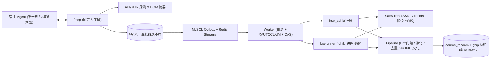

# GoRelay —— 面向 AI Agent 的外部数据接入与沙箱执行引擎（MCP Server）

GoRelay 是一个基于 **Go + MySQL + Redis + gopher-lua** 构建的轻量级 **MCP（Model Context Protocol）外部数据源连接器与隔离执行引擎**。

它让外部宿主 Agent（如 Codex、Claude Code 或业务 Agent）专注于任务规划与结果综合；一旦某类公开 API 或网页完成一次结构探测与校验，便在服务端沉淀为**不可变版本化连接器（`http_api` 声明式规格或沙箱 `Lua` 脚本）**，实现跨会话 1 步复用、断点续跑与原文证据溯源。

> **架构原则**：零内置聊天模型、零向量库重依赖、固定 6 个正交 MCP 工具、全部执行统一经由 MySQL Outbox + Redis Streams 可靠调度。

---

## 核心特性

- **固定 6 个 MCP 工具，防止宿主上下文膨胀**：已沉淀的连接器存放在 MySQL 版本库中按域名/URL 确定性检索，绝不动态向宿主膨胀注册几十上百个工具。
- **API 优先自动升级（`http_api` 免写代码）**：`gorelay_probe_source` 自动识别直连 JSON、HTML 内嵌 JSON（`__NEXT_DATA__` / JSON-LD）及可选 Sidecar XHR 接口并生成 `DraftAPISpec`；无需翻页解析时直接走声明式 `http_api` 执行器。
- **`gopher-lua` 独立子进程沙箱 + 页级断点续跑**：多步关联与复杂解析代码在隔离的 `-child` 子进程中执行（OS 内存限额、SSRF 内网禁访、能力白名单、取消强杀进程树）；提供 `checkpoint.get()` / `checkpoint.save(cursor, batch)` 原语，在同一个 MySQL 事务中完成数据落盘与 `WHERE id=? AND run_token=?` CAS 游标推进，崩溃接管直接从断点页续跑。
- **唯一统一可靠执行与并发合并**：单页、多页、`http_api`、`lua_sandbox`、`discovery` 全部统一走 `MySQL Outbox + Redis Streams + Lease + XAUTOCLAIM`；同参活跃任务跨会话 Singleflight 合并，`wait_ms` 窗口支持快任务 1 步同步直出。
- **共享流量治理（SafeClient）与静默失效保护**：所有探测与执行共用 SSRF DNS Pinning、`robots.txt` + `Crawl-delay`、域名令牌桶限速、429/WAF/Captcha 熔断器与 `5 MiB` 响应上限。落库前经过 `CheckSilentDrift` 门禁：一旦上游返回伪 200 拦截页或缺失必填字段，立刻标 `degraded` 保护旧有效快照不被污染。
- **防膨胀存储与原文溯源**：结构化记录按 `(source_id, entity_key) + content_hash` 精确去重与版本更新；原始响应按 SHA-256 gzip 归档并提供纯 Go BM25 `gorelay_search_evidence` 检索与 `/evidence?ref=<sha256>` 原文对照；单次 MCP 返回硬封顶 `<= 16 KiB` 自动分页。

---

## 系统架构



详细模块设计与接口边界见 [architecture-v2.md](docs/architecture-v2.md)。

---

## 固定 6 个 MCP 工具

| 工具名称 | 核心作用 |
| :--- | :--- |
| `gorelay_list_sources` | 基于 MySQL 对 `domain / url / keyword / kind (data \| discovery)` 做确定性查库，结合 `freshness_ttl_sec` 判断是否有可直接复用的新鲜结果 |
| `gorelay_probe_source` | 过 `SafeClient` 预检并探测直连 JSON、内嵌 JSON、可选 Sidecar XHR API 或精简 DOM 选择器，附带 `< 350 Token` 沙箱契约 |
| `gorelay_deploy_and_run` | 先同步试跑校验（失败不污染目录），通过后发布不可变 `v(N+1)`（或 `rollback_to` 回滚）并入队执行，`wait_ms` 内完成即同步吐出结果 |
| `gorelay_run_connector` | 1 步复用已发布连接器：支持新鲜缓存直出（0 外网请求）、多会话 Singleflight 合并、`wait_ms` 短等待与静默失效诊断 |
| `gorelay_get_job_data` | 查询长任务状态、按 `next_cursor` 分页读取 `<= 16 KiB` 清洗结果，或取消任务并强杀沙箱子进程 |
| `gorelay_search_evidence` | 在显式 `source_ids` 范围内用纯 Go BM25 检索归档长文本，或按 `snapshot_ref` 分页阅读 gzip 原文快照 |

---

## 目录导航

```text
cmd/
  server/       # Streamable HTTP /mcp 入口 + 只读管理台与 /evidence 静态页
  publisher/    # MySQL Outbox -> Redis Streams 投递器
  worker/       # Redis Streams 消费/接管 Worker + CAS checkpoint 回调中心
  lua-runner/   # 独立 OS 隔离沙箱 (-child / -serve HTTP / -snapshot-pipe)
  mcp-check/    # MCP 协议端到端探活与工具清单校验 CLI
  bench-mcp/    # 离线模拟与在线对照评估 CLI
internal/
  fetchgov/     # 共享 SafeClient、SSRF、robots.txt、令牌桶、429/WAF 熔断、Sidecar 接口
  probe/        # JSON / Embedded JSON / XHR / DOM 摘要探测器
  connector/    # 连接器版本注册表、http_api 执行器、Singleflight、CheckpointHub
  pipeline/     # Drift 门禁、防 Prompt 注入净化、内容哈希版本去重、gzip+BM25、16KB 打包
  mcpserver/    # 固定 6 工具 MCP Server 与统一 ToolFailure 契约
```

---

## 快速开始

### 1. 本地运行测试与离线模拟评估（无需 MySQL / Redis / Docker）

```bash
go test ./cmd/... ./internal/... ./deploy/...
go run ./cmd/bench-mcp -mode sim
```

使用 `-mode sim` 可在本地跑通“API 探测自动晋升 `http_api` → 页 2 断点续跑 → `output_schema` 裁剪压缩 → 伪 200 软封锁 Drift 拦截”完整不变量验证（实际环境端到端延迟与数据库吞吐需启动下方全栈容器后按实测为准）。

### 2. Docker Compose 启动全栈（MySQL + Redis + Server + Publisher + Worker + Lua-Runner）

```bash
cp .env.example .env
# 按需修改 .env 中的数据库密码与 GORELAY_ADMIN_TOKEN / GORELAY_RUNNER_TOKEN
docker compose up -d --build --wait
curl -f http://127.0.0.1:8080/healthz
```

- Web 控制台：`http://127.0.0.1:8080/`（连接器目录、复用命中率与 Drift 事件观测）
- MCP 客户端接入校验：`GORELAY_ADMIN_TOKEN=... go run ./cmd/mcp-check -url http://127.0.0.1:8080/mcp`
- Claude Code / Codex 客户端配置模板见 `configs/mcp/`。
