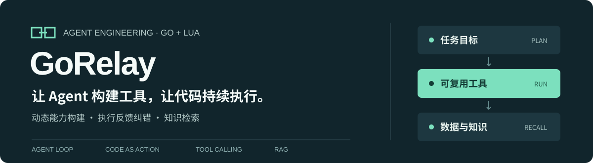
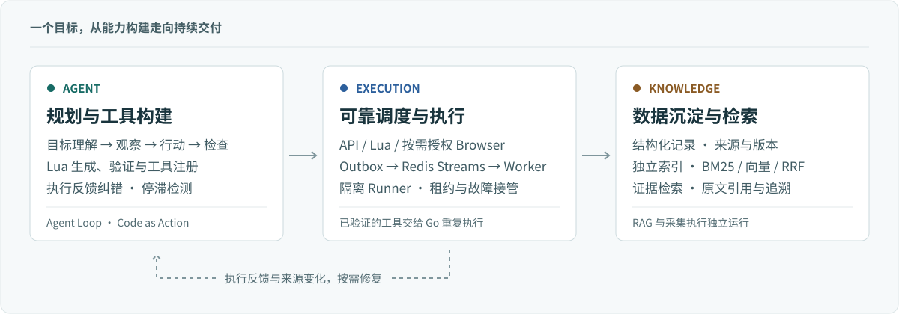

<p align="center">
  <picture>
    <source media="(max-width: 640px)" srcset=".github/assets/readme-hero-mobile.svg">
    
  </picture>
</p>

<p align="center">
  <strong>Agent 自主接入与可靠执行系统</strong><br>
  <sub>Go · Lua · MySQL · Redis Streams · Qdrant</sub>
</p>

<p align="center">
  <a href="#设计亮点">设计亮点</a> &nbsp;·&nbsp;
  <a href="#架构">架构</a> &nbsp;·&nbsp;
  <a href="#快速开始">快速开始</a> &nbsp;·&nbsp;
  <a href="#代码导航">代码导航</a>
</p>

---

软件版本、API 变更和技术公告分散在不同来源。持续跟踪这些信息，往往需要反复编写和维护适配脚本；每次都让 Agent 重新探索，又会重复消耗模型调用。

**GoRelay 让 Agent 完成新来源的探索、编码与验证，将可复用工具交给 Go 后端持续执行，来源变化时再按需修复。** 获取的数据进入独立知识链路，支持事实检索与原文追溯。

> 例如：跟踪 Go 和 Redis 的新版本，整理发布日期、关键变更与来源链接，并持续更新。

## 设计亮点

### 把一次探索，变成可复用的工具

采用 **Code as Action**，将分页、详情关联、字段转换等多步操作编排为 Lua 程序。程序经过隔离验证后，注册为版本化、参数化工具，后续任务直接复用。

执行路径优先使用原生 API，Lua 承接网页解析与控制流；遇到确认为反爬限制的问题，再按内部授权使用 Browser。

### 让失败产生反馈，让长任务保有状态

**Agent Loop** 接收工具返回的错误归因、具体诊断与修复步骤，驱动模型修改参数或程序。结合任务产出与每轮 Embedding 语义检测识别停滞，先纠偏，再根据后续行为决定继续或终止。

**Tool Calling** 由宿主按工具与规范化业务参数去重；工具回执、待修程序和诊断信息持久化，帮助任务在上下文压缩后继续执行。

### 把可靠执行与知识检索接成闭环

**Go 执行层**通过 MySQL 事务 Outbox 向 Redis Streams 投递任务，结合 Worker 接管、租约、CAS 与执行令牌处理故障和迟到提交。

**RAG 数据层**独立完成索引与检索，支持 BM25、BGE/Qdrant 向量检索和 RRF 融合；结构化结果、来源版本与原文证据关联，回答可以回到来源核查。

## 架构

<picture>
  <source media="(max-width: 640px)" srcset=".github/assets/architecture-mobile.svg">
  
</picture>

**采集与 RAG 各司其职。** Agent 通过选择器目录、链接和字段样本理解网页结构；完整正文由采集程序保存，再交给独立索引与检索链路。

<details>
<summary><strong>展开执行路径与恢复机制</strong></summary>

| 执行路径 | 适用场景 |
| :--- | :--- |
| **API** | 已有原生接口，直接获取结构化数据。 |
| **Lua** | 网页解析、分页、详情关联与多步数据处理。 |
| **Browser** | 内部反爬判定通过后，按需授权浏览器执行。 |

- 脚本和参数错误返回 Agent 修复，不直接切换 Browser。
- 同一任务中的业务请求身份不依赖模型调用 ID，换一个调用 ID 不会重复执行相同请求。
- 待输入或阻断的任务可恢复，并保留原有预算与任务状态。
- Embedding 停滞检测与知识库索引独立配置，服务失败会明确记录。

</details>

## 快速开始

**环境：** Go 1.26.1+、Docker Compose，以及一个 OpenAI-compatible 模型服务。

### 1. 准备配置

```bash
git clone https://github.com/KamiNeko-pre/GoRelay.git
cd GoRelay
cp .env.example .env
cp configs/agentbench/spend-policy.example.json configs/spend-policy.local.json
```

编辑 `.env`，填写数据库密码、管理令牌、Runner 令牌，以及模型服务的 URL、模型名称和密钥。上下文容量与输出上限按实际模型能力设置。

原生 API 任务还需要在 `configs/spend-policy.local.json` 中填写模型费率与 Token/费用上限，并在 `.env` 设置：

```dotenv
GORELAY_SPEND_POLICY_PATH=/app/configs/spend-policy.local.json
```

策略文件会随本地镜像构建复制到容器；模板中的空费率和零额度需要填写后才能受理任务。

### 2. 启动工作台

```bash
docker compose -f docker-compose.yml -f docker-compose.ai.yml config --quiet
docker compose -f docker-compose.yml -f docker-compose.ai.yml up -d --build
```

| 入口 | 可以做什么 |
| :--- | :--- |
| **[Agent 工作台](http://localhost:8080/agent)** | 创建目标、查看工具轨迹、检查任务结果。 |
| **[数据工作台](http://localhost:8080/)** | 浏览采集快照、筛选数据、分析变化。 |

<details>
<summary><strong>只想先检查代码？运行离线样本</strong></summary>

以下命令不启动 Docker，也不调用模型：

```bash
go build ./cmd/...
go run ./cmd/ai-check -mode replay -input inputs/ai/replay-pagination-detail.json
go run ./cmd/agent-eval -mode validator -output output/validator-audit.json
```

回放按请求方法、完整 URL 与调用顺序匹配响应，检查分页和详情关联。更多用法见 [离线样本](inputs/ai/README.md) 与 [评测工具](configs/agentbench/README.md)。

</details>

<details>
<summary><strong>启用向量索引、Browser 与部署配置</strong></summary>

**向量索引：** 配置 Embedding 服务、实际维度与 Qdrant，然后启动独立索引进程：

```bash
docker compose -f docker-compose.yml -f docker-compose.ai.yml --profile indexing up -d --build
```

**Browser：** 单独安装 Node.js、Playwright 及浏览器，并配置执行位置。默认镜像没有预装完整浏览器环境；Browser 仅在内部反爬授权后启用。

**部署与权限：**

- 管理接口及模型调用使用 Bearer 令牌；Lua Runner 使用独立私有令牌。
- Runner 仅开放受控 GET/HEAD，校验目标地址与重定向；容器不挂载 Docker socket 或宿主文件。
- 总任务时限按请求和环境变量配置；I/O、Runner 资源预算及取消控制独立生效。
- `.env`、真实密钥、私有实验材料与原始响应保存在本地。

部署细节见 [部署说明](deploy/README.md)，配置入口见 [环境变量模板](.env.example)。

</details>

## 代码导航

沿着一次任务的执行顺序阅读：

| 模块 | 职责 |
| :--- | :--- |
| [`internal/aiapp`](internal/aiapp) | Agent Loop、工具宿主、错误反馈与上下文管理 |
| [`internal/agentdata`](internal/agentdata) | Agent 状态、来源注册与持久化契约 |
| [`internal/information`](internal/information) | API / Lua / Browser 路由与信息工作流 |
| [`internal/engine`](internal/engine) | Lua 执行、DOM / JSON 能力与结果契约 |
| [`internal/worker`](internal/worker) · [`internal/repository`](internal/repository) | 队列消费、执行权控制、Outbox 与结果存储 |
| [`internal/knowledge`](internal/knowledge) | 文档、索引、检索与证据版本 |
| [`web`](web) · [`cmd`](cmd) | 工作台与服务、Worker、Runner 等启动入口 |

<details>
<summary><strong>HTTP API 入口</strong></summary>

| 接口 | 用途 |
| :--- | :--- |
| `POST /api/v1/agent/runs` | 创建 Agent 任务 |
| `GET /api/v1/agent/runs/:id` | 查询状态、工具轨迹、预算与结果 |
| `POST /api/v1/agent/runs/:id/resume` | 恢复待输入或阻断任务 |
| `POST /api/v1/information/requests` | 创建信息获取与检索工作流 |
| `POST /api/v1/knowledge/query` | 检索证据并生成带来源的回答 |
| `POST /api/v1/tasks` | 提交已知规则的执行任务 |

</details>

---

<p align="center">GoRelay · <a href="LICENSE">MIT License</a></p>
