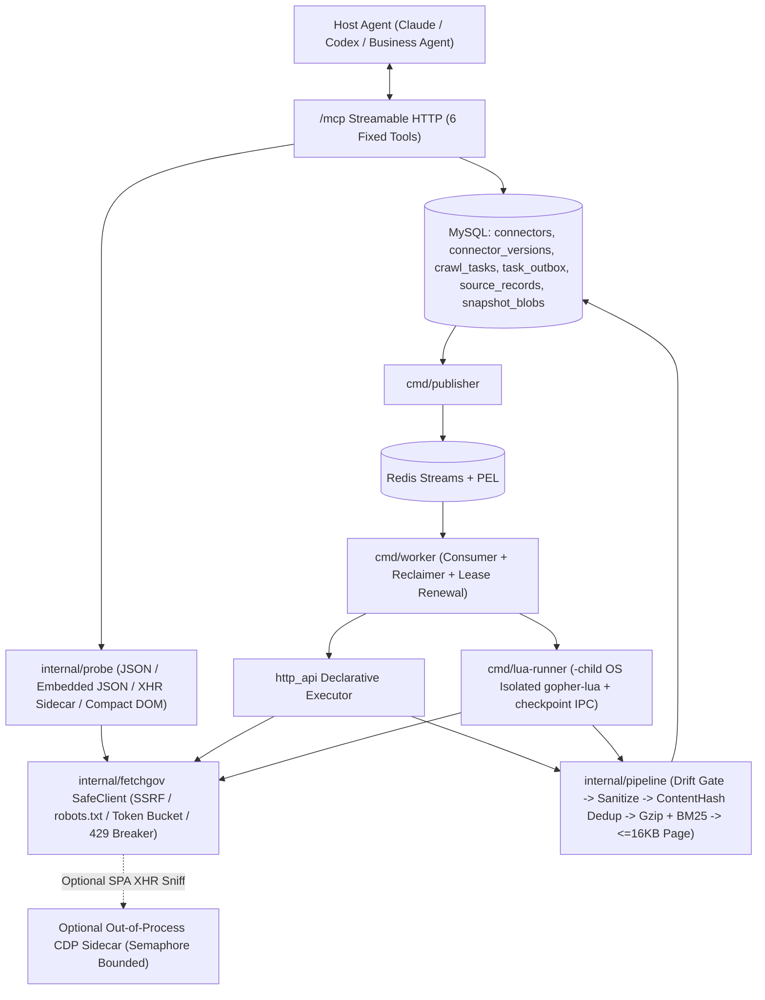

# GoRelay v2 Architecture Specification

## 1. Design Goals & Hard Constraints

GoRelay v2 is a **deterministic, zero-LLM MCP External Connector & Sandboxed Execution Engine** written in Go (`gorelay` module).

1. **Zero Internal Chat LLM / Zero Vector Store**: The host Agent retains 100% of planning, script authoring, repair, and final synthesis. GoRelay runs no internal planner LLM, Eino graph, or Qdrant vector cluster.
2. **Fixed 6-Tool MCP Surface**: Connectors (`http_api` JSON specs or `gopher-lua` scripts) are persisted as immutable versions in MySQL rather than registered dynamically as new MCP tools, preventing host context-window bloat.
3. **Deterministic Lookup + Recursive Discovery**: Stored connectors are matched deterministically by `domain`, `url`, `keyword`, or `kind`. Unknown target lists are resolved explicitly by the host via `kind="discovery"` sub-connectors before collecting data.
4. **Single Reliable Execution Plane**: Every connector execution (`http_api` or `lua_sandbox`, single-page or multi-page) runs through `MySQL (crawl_tasks + task_outbox) -> Publisher -> Redis Streams -> Worker (lease + XAUTOCLAIM + CAS fencing token)`. Fast runs return within `wait_ms` synchronously over the MCP response.
5. **Shared Fetch Governance (`internal/fetchgov`)**: All HTTP probing and execution pass through `SafeClient` enforcing SSRF IP/CIDR blocking, DNS pinning, `robots.txt` + `Crawl-delay`, per-domain token buckets, 429/WAF/Captcha circuit breaking, `Content-Type` allowlisting, and `5 MiB` `io.LimitReader` bounds.

## 2. System Topology

## 3. Package Responsibilities

| Package | Responsibility |
| :--- | :--- |
| `internal/fetchgov` | SSRF-checked `Requester` wrapper, RFC 9309 `RobotsCache`, per-domain `rate.Limiter` + `CircuitBreaker`, `429/WAF/Captcha` signal classifier, scoped `AuthProfile` injection, optional semaphore-limited `PageRenderer` sidecar client. |
| `internal/probe` | API-first source inspection (`SummarizeJSON`, `ExtractEmbeddedJSON`, optional Sidecar XHR API capture, compact DOM selector samples) plus the compact `< 350` token `LuaSandboxContract`. |
| `internal/connector` | MySQL connector & immutable version registry (`rollback_to` support), trial validation gate, active-job singleflight dedup, `http_api` JSON pointer + pagination executor, `CheckpointHub` IPC callback handler, and `hot` 14-day canary monitor. |
| `internal/pipeline` | Inline `CheckSilentDrift` gate (soft-block / missing required fields preserve last known good `source_records`), indirect-prompt-injection text sanitization, nullable `is_current` `(source_id, entity_key)` + `content_hash` versioned upsert, gzip snapshot archival + pure-Go BM25 `SearchEvidence`, and `<= 16 KiB` response budget packing. |
| `internal/mcpserver` | Stateless Streamable HTTP `/mcp` server exposing 6 fixed tools with structured `ToolFailure{Code, RecoverySteps}` contracts. |
| `cmd/lua-runner` | OS-isolated `-child` process executor (`Windows Job Object` memory/termination guard, Linux `Setpgid` process group kill) with stdin/stdout JSON-lines pipe for lazy snapshot lookup and atomic `checkpoint.get` / `checkpoint.save`. |
| `cmd/publisher`, `cmd/worker` | Durable MySQL Outbox poller and Redis Streams worker (`XREADGROUP` + `XAUTOCLAIM` + lease heartbeat + CAS fencing token). |
